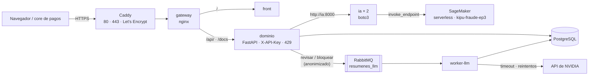

# Guardián Centinela · detección de fraude explicable para Kipu Pagos

ITY1102 · Arquitectura de Sistemas de IA · Equipo 4 · Caso 3 (fraude).

Por cada transacción, el sistema devuelve **aprobar, revisar o bloquear** con la probabilidad de fraude y las **razones
ordenadas por peso**, calculadas por un modelo propio (red aditiva NAM) servido desde un **endpoint serverless de
Amazon SageMaker**. Para lo que queda en revisión o bloqueo, un **LLM de NVIDIA** redacta por una **cola RabbitMQ** un
resumen en lenguaje común para el analista. El LLM nunca decide y nunca bloquea la respuesta: si falla, la predicción
sigue funcionando en **modo degradado**.

## Arquitectura (EP3)



Todo corre con Docker Compose en una EC2 del Learner Lab. Solo Caddy publica puertos (80 y 443). Las credenciales
de AWS vienen del perfil `LabInstanceProfile` de la EC2: no hay claves de AWS en ningún archivo.

| Servicio | Carpeta | Qué hace |
|---|---|---|
| caddy | `Caddyfile` | HTTPS con certificado de Let's Encrypt en `https://<ip-con-guiones>.sslip.io` |
| gateway | `servicio-gateway/` | nginx: `/` al front, `/api/` y `/docs` al dominio. La IA no tiene ruta pública |
| front | `servicio-front/` | Evaluación de transacciones, resumen del LLM, dashboard (RF12) y cola de revisión |
| dominio | `servicio-dominio/` | API de negocio, lista negra y reglas duras (RF4, RF8), política de reserva (RNF3), clave de API, límite por cliente, publica en la cola |
| worker-llm | `servicio-dominio/worker.py` | Consume la cola, anonimiza y llama a NVIDIA con timeout, reintentos y modo degradado |
| ia | `servicio-ia/` | Valida, invoca el endpoint de SageMaker y convierte la probabilidad en decisión con umbrales de configuración (RF3) |
| carga | `servicio-carga/` | Esquema y carga idempotente de los datos tratados en PostgreSQL |
| — | `aws/` | Scripts reproducibles: datos a S3, Training Job, endpoint serverless, métricas, latencia y costo |
| — | `datos/` | Tratamiento de los datos crudos (`preparar.py`) |

## API

| Ruta | Clave | Qué devuelve |
|---|---|---|
| `POST /api/predict` | sí | Decisión, probabilidad, razones, versión del modelo y `estado_llm` |
| `GET /api/predicciones/{id}` | sí | La predicción guardada con el resumen del LLM cuando está listo |
| `GET /api/predicciones?transaccion_id=...` | sí | Todas las decisiones de una transacción (RF7, auditoría) |
| `GET /api/revision` | sí | Cola de revisión priorizada por pérdida esperada (probabilidad × monto) (RF5) |
| `GET /api/dashboard` | sí | Evaluadas, distribución de decisiones, tasa de bloqueo por día (RF12) |
| `GET /api/health` | no | Estado separado de base, SageMaker, cola y LLM |
| `GET /docs` | no | Documentación OpenAPI |

Sin `X-API-Key` → 401 · entrada inválida o campo fuera del contrato (por ejemplo el número de tarjeta) → 422 con
detalle · más de `LIMITE_POR_MINUTO` solicitudes por cliente → 429.

```bash
curl -X POST https://<ip-con-guiones>.sslip.io/api/predict -H "X-API-Key: <clave>" -H 'content-type: application/json' \
  -d '{"usuario_id":"KP301626","comercio_id":"CM40294","monto":900000,"moneda":"CLP","canal":"app","mcc":"5411","pais_transaccion":"CL"}'
```

## Despliegue en AWS (EC2 del Learner Lab)

1. **Endpoint** (desde un computador con las credenciales del Learner Lab): ver [`aws/README.md`](aws/README.md).
   El paso 03 se ejecuta con `--endpoint kipu-fraude-ep3 --concurrencia 10`.
2. **EC2** `t3.medium`, Ubuntu 24.04, perfil `LabInstanceProfile`, IP elástica, grupo de seguridad con 80 y 443 a
   internet y 22 solo a la IP del equipo, y hop limit 2 (para que boto3 obtenga las credenciales desde Docker):
   `aws ec2 modify-instance-metadata-options --instance-id <id> --http-put-response-hop-limit 2 --http-endpoint enabled`
3. En la EC2:

```bash
git clone https://github.com/ser-martinezs/deteccion-fraude-kipu.git && cd deteccion-fraude-kipu
cp .env.example .env && nano .env      # DOMINIO, API_KEYS, contraseñas, NVIDIA_API_KEY, NVIDIA_MODEL
docker compose -f compose.yaml -f compose.aws.yaml pull
docker compose -f compose.yaml -f compose.aws.yaml up -d
docker compose -f compose.yaml -f compose.aws.yaml ps
```

Los logs de dominio, ia, worker-llm, gateway y caddy llegan a **CloudWatch Logs**, grupo `/kipu/ep3`.

### Variables del `.env` (los valores reales nunca van al repositorio)

| Variable | Para qué |
|---|---|
| `DOMINIO` | `3-85-10-20.sslip.io` (la IP elástica con guiones) |
| `TAG` | Versión de las imágenes: `ep3` en la entrega, `latest` para probar lo que está en `main` |
| `API_KEYS` | Claves de API aceptadas, separadas por coma (`openssl rand -hex 16`) |
| `POSTGRES_PASSWORD`, `RABBITMQ_PASSWORD` | Contraseñas internas |
| `NVIDIA_API_KEY`, `NVIDIA_MODEL` | Clave y modelo del LLM (el publicado por el docente) |
| `SAGEMAKER_ENDPOINT` | `kipu-fraude-ep3` |
| `IA_TIMEOUT_MS` | Cuánto espera el dominio al modelo antes de la política de reserva (6000) |
| `POLITICA_RESERVA` | `reglas`, `aprobar` o `bloquear` cuando el modelo no responde |
| `LIMITE_POR_MINUTO` | Solicitudes por minuto por cliente antes del 429 (3000; subirlo solo para Locust) |

## Desarrollo local

```bash
cp .env.example .env            # completar API_KEYS
docker compose pull && docker compose up -d
# http://localhost:8080 (sin HTTPS; la IA necesita credenciales de AWS para llegar a SageMaker)
```

## Pruebas

- **Automatizadas** (las corre el pipeline en cada pull request, antes de publicar imágenes):
  `servicio-dominio/test_ep3.py` tiene las seis obligatorias de EP3 (predicción válida, 422, 401, 429,
  anonimización, LLM con 429 o caído → modo degradado) más pruebas extra; hay pruebas también en `datos/`,
  `servicio-carga/` y `servicio-ia/`.
- **Carga** con Locust contra AWS: ver [`pruebas/locustfile.py`](pruebas/locustfile.py).

```bash
API_KEY=<clave> locust -f pruebas/locustfile.py --headless -u 20 -r 5 -t 3m --host https://<dominio> --csv pruebas/resultados/carga
```

## Pipeline

GitHub Actions, un workflow por servicio (`.github/workflows/`): en cada pull request construye la imagen y la prueba;
en `main` la publica en GHCR como `sha-<commit>` y `latest`; con los tags `ep2` / `ep3` re-etiqueta la misma imagen
ya probada. Flujo de ramas: `feat/*` → `dev` → `main`.

## Equipo

| Integrante | Usuario | Pieza |
|---|---|---|
| Sergio Martínez | `ser-martinezs` | Datos, modelo NAM, SageMaker, servicio-ia |
| Oscar Larrieu | `oscarL22997` | Dominio, base de datos, cola RabbitMQ, worker LLM, seguridad de la API |
| Roberto Castro | `robertcast-hub` | Infraestructura AWS, HTTPS, gateway, front y dashboard, prueba de carga |
